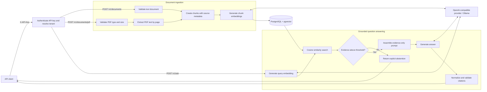

# Production RAG API

A **FastAPI Retrieval-Augmented Generation (RAG) API** built with Python, PostgreSQL, and pgvector. It demonstrates document and PDF ingestion, embedding-based semantic search, evidence-grounded question answering, page-level citations, explicit abstention when retrieved evidence is insufficient, and a versioned RAG evaluation harness.

> **Reviewer summary:** This repository is a testable RAG prototype with API-key authentication and tenant-scoped storage/retrieval—not a production-ready identity platform. It is designed to make retrieval, grounding, citation, evaluation, security, and operational trade-offs inspectable. Start with the architecture, verified results, and security boundaries below.

**Core technologies:** Python · FastAPI · PostgreSQL · pgvector · embeddings · OpenAI-compatible APIs · Ollama · pytest · Docker Compose · GitHub Actions

**What to inspect:** [Architecture](#architecture) · [Engineering decisions](#engineering-decisions-and-trade-offs) · [Verified results](#verified-results) · [API endpoints](#api) · [Tests](#tests-and-quality-checks) · [Security boundaries](#security-boundaries) · [Known limitations](#known-limitations)

> **Current milestone:** Validated local PDF RAG prototype with page-aware citations, tenant isolation, PostgreSQL/pgvector integration coverage, and versioned v1/v2 evaluation baselines. It remains a local prototype, not a production-ready service.

See the [validation report](docs/validation-report.md) for the exact implemented scope, automated
test evidence, local Ollama results, and remaining limitations.

## What this project demonstrates

- **Backend design:** typed API contracts, input validation, persistence boundaries, and environment-based configuration.
- **RAG fundamentals:** document chunking, embedding generation, cosine-distance retrieval, and source metadata.
- **Grounding behavior:** evidence thresholding and an explicit insufficient-evidence response.
- **Reliability basics:** bounded inputs, parameterized SQL, provider timeouts/retries, and no raw infrastructure details in API error responses.
- **Security boundary:** fail-closed API-key authentication and mandatory tenant-scoped replacement and retrieval.
- **Engineering discipline:** isolated unit tests, real PostgreSQL/pgvector integration tests, and a GitHub Actions workflow.

## Architecture



The API emits request-correlated timings around embedding, retrieval, generation, and total
request duration. These logs make the provider and database boundaries observable without exposing
internal exception details to clients.

## Engineering decisions and trade-offs

| Decision | Why it is used | Deliberate limitation / next experiment |
|---|---|---|
| Dense cosine retrieval with pgvector | Keeps the first retrieval path small, inspectable, and covered by real database integration tests. | No BM25, hybrid search, or reranker is implemented. Compare those approaches against the versioned evaluation set before adopting one. |
| Page-scoped, overlapping character chunks | Preserves PDF page provenance and makes returned citations verifiable. | Character windows can split semantic structures; token- or heading-aware chunking needs measured comparison. |
| Similarity threshold before generation | Unsupported questions can abstain without paying generation latency or encouraging an unsupported answer. | The `0.60` threshold was calibrated on a small synthetic dataset and is not universally valid. |
| Structured sources plus citation normalization | Callers receive authoritative source metadata, while model-produced labels are restricted to retrieved chunk/page pairs. | The answer is still model-generated text, not schema-constrained JSON; clients should render citations from `sources`. |
| Synchronous provider and database calls | Keeps the local prototype easy to reason about and test end to end. | It is not designed for high concurrency; async I/O, pooling, queues, and streaming require separate load evidence. |
| OpenAI-compatible provider boundary | Supports local Ollama and other compatible providers through configuration. | Retries and timeouts are configurable, but multi-provider failover and rate-limit orchestration are not implemented. |
| Server-resolved API-key tenant | Callers cannot select a tenant ID; every write, replacement, and vector search receives the tenant resolved from `X-API-Key`. | Static API keys are suitable for this prototype, not full user identity. Public deployment still needs managed secrets, key rotation/revocation, roles, audit retention, rate limits, and stronger identity infrastructure. |

## Verified results

These results are committed, reproducible project evidence—not general performance claims:

| Validation | Result | Evidence |
|---|---:|---|
| v1 evaluation | 6 cases; 100% retrieval, answer, citation, and abstention accuracy after citation normalization | [v1 notes and baselines](evals/v1/README.md) |
| Isolated v2 evaluation | 8 cases; 100% retrieval, answer, citation, and abstention accuracy | [v2 notes and baseline](evals/v2/README.md) |
| Repeated generated path | 54.868 s server p50; 65.889 s p95 | [latency methodology and baseline](evals/latency/README.md) |
| Repeated abstention path | 0.340 s server p50; 0.835 s p95 | [latency methodology and baseline](evals/latency/README.md) |
| Automated verification | Unit tests plus real PostgreSQL/pgvector integration tests and Docker image build | [validation report](docs/validation-report.md) |

The evaluation corpora are intentionally small and synthetic. Perfect scores demonstrate regression
coverage for these declared cases, not production accuracy on arbitrary documents. The repeated
latency run shows that local CPU answer generation is the dominant cost; it is not a production SLO
or concurrency benchmark.

## API

| Endpoint | Purpose |
|---|---|
| `GET /health` | Liveness check |
| `POST /v1/documents` | Chunk, embed, and store a text document |
| `POST /v1/documents/pdf` | Extract, chunk, embed, and store a PDF with page numbers |
| `POST /v1/ask` | Retrieve evidence and generate a grounded answer |

`GET /health` is public. Every `/v1/*` request requires `X-API-Key`. The server maps that key to a
tenant from `TENANT_API_KEYS`; clients never supply or override `tenant_id`.

### Example: ingest a document

```json
{
  "document_id": "handbook-1",
  "title": "Team handbook",
  "text": "Vacation requests should be submitted two weeks in advance."
}
```

Send that body to `POST /v1/documents` with the header `X-API-Key: <your-key>`.

### Example: ingest a PDF

Upload a text-based PDF as multipart form data. Scanned/image-only PDFs require OCR and are
not supported in this milestone.

```bash
curl -X POST http://127.0.0.1:8000/v1/documents/pdf \
  -H "X-API-Key: $RAG_API_KEY" \
  -F "document_id=handbook-pdf" \
  -F "title=Team handbook" \
  -F "file=@handbook.pdf;type=application/pdf"
```

Each extracted page is chunked independently. Retrieval sources include `page_number`, and the
answer-generation prompt asks the model to preserve that page citation.

### Example: ask a question

```json
{
  "question": "How early should I submit a vacation request?",
  "top_k": 5
}
```

Send the body with `X-API-Key: <your-key>`. The answer response includes `answer`, `abstained`, and `sources` with document IDs, chunk IDs, source text, and similarity scores. Every response includes an `X-Request-ID` header; a safe caller-supplied ID is preserved, otherwise the API generates one. Completed ask requests emit a `rag_request_completed` log record with `request_id`, `embedding_ms`, `retrieval_ms`, `generation_ms`, `total_ms`, `abstained`, and `evidence_count`. Failed provider/database stages emit `rag_stage_failed` or ingestion-specific error logs with the same request ID. Client responses remain generic and do not expose exception details.

Follow the structured JSON timing events from the running container with:

```bash
docker compose logs --follow api
```

An abstained request emits a record shaped like:

```json
{"abstained":true,"embedding_ms":9460.59,"event":"rag_request_completed","evidence_count":0,"generation_ms":0.0,"request_id":"rag003-live-validation","retrieval_ms":67.543,"total_ms":9530.085}
```

The values above are one local CPU observation, not a latency guarantee. Generated answers use the
same fields with `abstained=false` and a non-zero `generation_ms`.

## Docker Compose (recommended for a reproducible setup)

Prerequisites: Docker Desktop (or Docker Engine with the Compose plugin) and Ollama running. The default Compose configuration expects `nomic-embed-text` and `qwen3:4b` to be installed in Ollama on the host.

1. Create your local environment file:

   **Windows PowerShell**
   ```powershell
   Copy-Item .env.example .env
   notepad .env
   ```

   Replace the example `TENANT_API_KEYS` value with a JSON mapping from tenant IDs to independently
   generated secrets of at least 16 characters. The example configuration uses the local Ollama
   server through Docker Desktop's `host.docker.internal` address. Override the provider variables
   if you want to use another OpenAI-compatible service. Never commit real credentials.

2. Start the API and PostgreSQL/pgvector:

   ```bash
   docker compose up --build
   ```

   The database schema is applied automatically when the PostgreSQL data volume is first initialized. The API waits for PostgreSQL's health check before starting.

3. Open `http://127.0.0.1:8000/docs`. Check `GET /health` first.

4. Stop the services with `Ctrl+C`, then run:

   ```bash
   docker compose down
   ```

   Database data remains in the named Docker volume. To **permanently delete** that local database and its data, run `docker compose down -v`.

The default local Ollama configuration uses a placeholder API key because the OpenAI client requires a value, while Ollama ignores it. Docker Compose is a local development setup, not a production security configuration; its database password is intentionally simple and must not be reused in a public deployment.

## Local setup

Requires Python 3.11+ and PostgreSQL with the pgvector extension.

1. Create and activate a virtual environment.

   **Windows PowerShell**
   ```powershell
   python -m venv .venv
   .venv\Scripts\Activate.ps1
   ```

   **macOS/Linux**
   ```bash
   python -m venv .venv
   source .venv/bin/activate
   ```

2. Install the package and development dependencies:

   ```bash
   pip install -e ".[dev]"
   ```

3. Create a PostgreSQL database, enable pgvector, and apply the schema:

   ```sql
   CREATE EXTENSION IF NOT EXISTS vector;
   ```

   ```bash
   psql "$DATABASE_URL" -f sql/schema.sql
   ```

4. Copy `.env.example` to `.env` and set `DATABASE_URL`, `OPENAI_API_KEY`, and `TENANT_API_KEYS`. Never commit real credentials.

5. Start the service:

   ```bash
   uvicorn app.main:app --reload
   ```

   Open `http://127.0.0.1:8000/docs` for the interactive API documentation.

## Configuration

| Variable | Default | Purpose |
|---|---|---|
| `DATABASE_URL` | Required | PostgreSQL connection string |
| `OPENAI_API_KEY` | Empty | Provider key; use any non-empty value for local Ollama |
| `OPENAI_BASE_URL` | Provider default | OpenAI-compatible endpoint; Compose uses `http://host.docker.internal:11434/v1` |
| `EMBEDDING_MODEL` | `text-embedding-3-small` | Embedding model; Compose uses `nomic-embed-text` |
| `CHAT_MODEL` | `gpt-4o-mini` | Answer-generation model; Compose uses `qwen3:4b` |
| `PROVIDER_TIMEOUT_SECONDS` | `600` | Per-request provider timeout; CPU-only local models may be slow |
| `PROVIDER_MAX_RETRIES` | `0` | Provider retry count |
| `TOP_K` | `5` | Default retrieval count |
| `MIN_SIMILARITY` | `0.60` | Locally measured cosine threshold; recalibrate with broader evaluation data |
| `CHUNK_SIZE` | `1200` | Character window size |
| `CHUNK_OVERLAP` | `150` | Character overlap |
| `MAX_PDF_UPLOAD_BYTES` | `10485760` | Maximum PDF upload size (10 MiB); larger uploads return HTTP 413 |
| `TENANT_API_KEYS` | `{}` | JSON object mapping tenant IDs to unique API keys of at least 16 characters; protected routes fail closed when empty |

## Tests and quality checks

```bash
ruff check app evals tests
pytest -m "not integration"
```

Integration tests require a reachable PostgreSQL database with the pgvector extension and an
applied schema. With `DATABASE_URL` configured, run:

```bash
pytest -m integration
```

The integration suite exercises the real API/repository/database boundary. It verifies text
ingestion persistence, transactional document replacement, cosine-similarity ordering, and page
metadata. Provider calls are replaced with deterministic embeddings so CI does not depend on a
model server or network behavior. These tests prove storage and retrieval mechanics; they do
**not** measure semantic retrieval quality, answer correctness, citation support, or provider
latency. Those are measured separately by the versioned evaluation harness below.

## RAG evaluation dataset

`evals/v1` contains a versioned, reviewable benchmark with a deterministic four-page PDF, four
answerable questions, and two deliberately unsupported questions. It measures expected-page
retrieval, required facts in generated answers, model citations that map to returned structured
sources, abstention, and end-to-end question latency.

The [v1 evaluation notes](evals/v1/README.md) define each metric and record the first local Ollama
baseline, including the observed citation-format failures and hardware conditions.

Start the complete API stack with Ollama available, then run:

```bash
python -m evals.v1.evaluate
```

The evaluator re-ingests its namespaced document ID on every run and writes the detailed report to
`evals/v1/results/latest.json`. Generated reports are ignored by Git because results depend on the
machine, configured models, threshold, and runtime conditions. Record those conditions alongside
any published benchmark. Rebuild the committed PDF deterministically after editing
`evals/v1/corpus/pages.json` with:

```bash
python -m evals.v1.build_corpus
```

The expanded v2 benchmark covers two synthetic documents, paraphrased questions, related distractors, multi-page answers, and unsupported near-miss questions. Run it with `python -m evals.v2.evaluate` while the API and Ollama stack are running. Its expected facts and page labels were manually reviewed on 2026-10-29, and the first isolated local baseline is documented in `evals/v2/README.md`.

For repeated stage-level measurements, use the controlled
[latency benchmark](evals/latency/README.md). It separates warm-up from measured requests and
summarizes the structured container events by generated and abstained paths.

## Roadmap

- [x] Make CI pass and record the result (GitHub Actions lint and unit tests passed for the scaffold).
- [x] Verify the Docker Compose PostgreSQL/pgvector setup on a local machine.
- [x] Add integration tests for ingestion, document replacement, and retrieval ordering.
- [x] Add PDF upload, text extraction, and page-level source citations.
- [x] Create a small, versioned question/answer evaluation dataset.
- [x] Measure retrieval Recall@k, abstention behavior, and grounded-answer quality on dataset v1.
- [x] Emit request-correlated stage timings as structured JSON events in container logs.
- [x] Record repeated local generated/abstention latency and identify the CPU generation bottleneck.
- [x] Add API-key authentication and tenant-scoped document replacement and retrieval tests.

## Security boundaries

- Retrieved document text is untrusted input. The generation prompt tells the model to treat evidence as data rather than instructions, but prompt wording is not a complete prompt-injection defense.
- Do not place secrets in indexed documents, and do not treat generated answers or citations as authorization decisions. Validate any future tool/action arguments independently.
- API keys resolve tenant identity on the server, and repository operations require that tenant ID.
  Clients cannot request another tenant directly. Cross-tenant replacement and retrieval are covered
  by real PostgreSQL integration tests.
- Static API keys do not provide end-user identity, roles, delegated permissions, rotation/revocation
  workflows, or a durable audit trail. Do not treat this prototype as a complete authorization system.
- The included Docker Compose database credentials are for local development only. A public
  deployment requires managed secrets, network restrictions, rate limits, resource limits, key
  lifecycle management, and operational monitoring.

## Known limitations

- Character-based chunking is intentionally simple; compare against token-aware and structure-aware chunking later.
- The similarity threshold is a starting point, not a universal guarantee of relevance.
- Tenant isolation is application-enforced with mandatory SQL predicates, not PostgreSQL row-level
  security. A production deployment should consider defense in depth and database roles/RLS.
- API handlers currently call provider/database functions synchronously. Evaluate async execution, connection pooling, and background ingestion only after measuring the MVP.
- A collection must use embeddings with a consistent dimension so pgvector distance operations can compare them.
